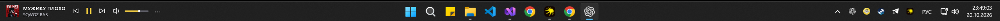
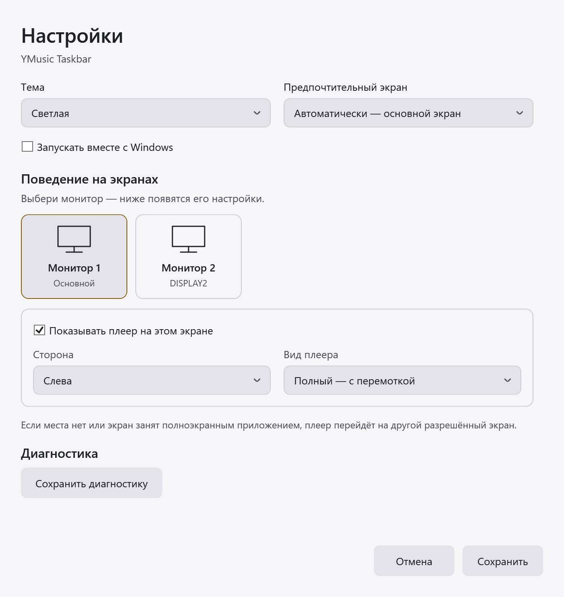

# YMusic Taskbar

A free, unofficial mini player for the supported desktop music app, placed **inside the Windows 10 / 11 taskbar**. Control music next to your app icons without opening the main player window.

[Русский](README.md) · [Usage guide (Russian)](USAGE.md) · [Download](https://github.com/kostyaLem/ymusic-taskbar/releases) · [MIT](LICENSE)

*The player inside the Windows taskbar. Click the screenshot to view it at full size.*

## Features

- Artwork, artist and track title.
- Play / pause, previous / next and seeking.
- Volume and mute.
- Full and compact layouts; light, dark and system themes.
- Independent side and layout preferences per display, with optional startup.

Open **⋯ → Настройки…** (Settings), also available from the tray icon. The player follows free taskbar space and moves away from displays occupied by fullscreen apps. The current UI language is Russian.

Compact layout and settings

## Requirements

- **Windows 10 22H2 or Windows 11, x64.**
- **About 200 MB** of disk space.
- **.NET 10 Desktop Runtime x64** (version 10.0.11 included in the installer and portable ZIP).

## Download and install

One installer supports both operating systems. Published versions appear in **[Releases](https://github.com/kostyaLem/ymusic-taskbar/releases)**. Run `YMusicTaskbar-0.5.0-win-x64-Setup.exe`, start a track in the desktop music app, then launch the mini player from the Start menu. Administrator rights are not required.

For a portable copy, extract the **entire** ZIP and run `YMusicTaskbar.exe`.

If no release is published yet, download **YMusicTaskbar-windows** under Artifacts in the latest successful **[app build](https://github.com/kostyaLem/ymusic-taskbar/actions/workflows/build.yml)** (GitHub sign-in required).

Builds are currently unsigned, so Windows may show an unknown-publisher warning. Checksums are included in `SHA256SUMS.txt`.

## Project and license

Free [open-source software](https://github.com/kostyaLem/ymusic-taskbar) under the [MIT license](LICENSE). [Third-party components](THIRD-PARTY.md).

This independent project is not affiliated with or endorsed by the music service. The project icon is original.